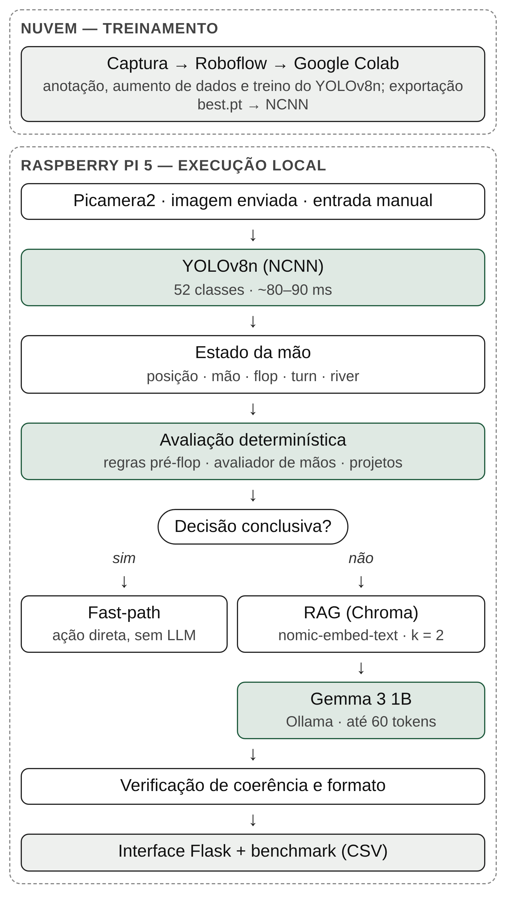
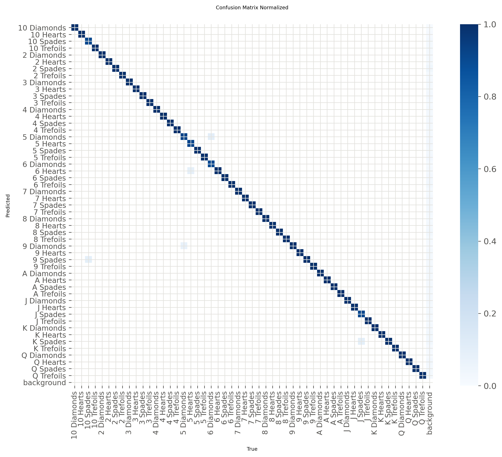
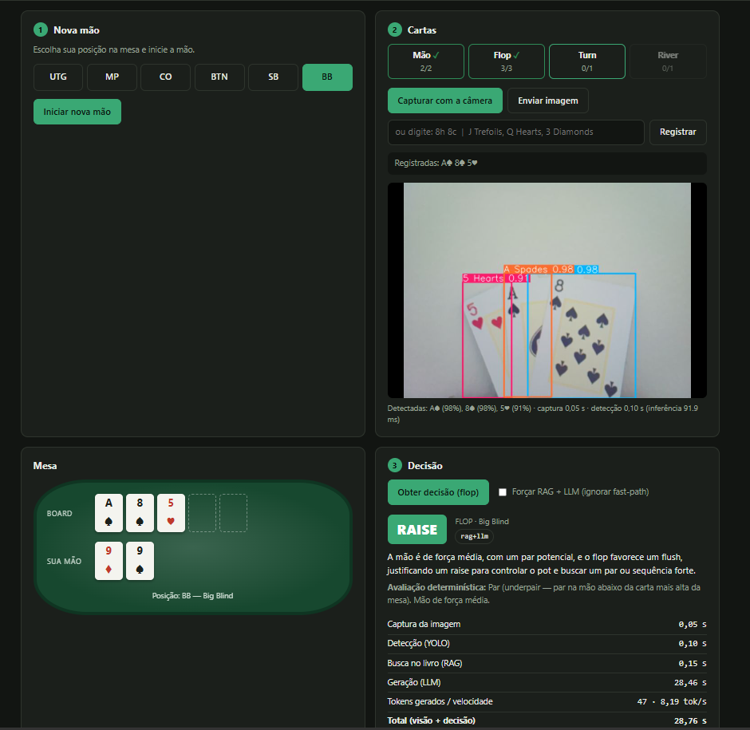

# Visão computacional embarcada para reconhecimento de cartas e avaliação de cenários do pôquer

Trabalho de Conclusão de Curso em Engenharia Eletrônica, UNIFEI (IESTI), 2026.

**Aluno:** Felipe Emanuel Pereira Gonçalves
**Orientador:** José Alberto Ferreira Filho
**Coorientador:** Marcelo José Rovai

Este é um sistema que roda inteiro em uma Raspberry Pi 5, sem nuvem. Ele reconhece as cartas de uma mão de Texas Hold'em pela câmera e recomenda uma ação (Fold, Call/Check ou Raise) com justificativa. O fluxo tem cinco partes:

- **Detecção:** um YOLOv8n exportado para NCNN identifica as 52 cartas.
- **Avaliação:** um avaliador determinístico classifica a mão.
- **Caminho rápido:** resolve sozinho os casos conclusivos.
- **Modelo de linguagem:** o Gemma 3 1B, com Geração Aumentada por Recuperação (RAG), propõe a ação e a justificativa nos casos ambíguos. Os resultados indicam que a escolha da ação deve ficar com as regras e que o papel adequado do modelo é explicar a recomendação.
- **Interface:** uma aplicação Flask valida e mede cada etapa.

📄 **Documento completo:** [docs/TCC_Felipe_Goncalves.pdf](docs/TCC_Felipe_Goncalves.pdf)

<p align="center"></p>

## Principais resultados

### Detecção de cartas (modelo embarcado: YOLOv8n, 50 épocas)

| Conjunto | Imagens | P | R | mAP50 | mAP50-95 |
|---|---:|---:|---:|---:|---:|
| Treino | 6.285 | 0,992 | 0,988 | 0,994 | 0,971 |
| Validação | 283 | 0,989 | 0,988 | 0,993 | 0,983 |
| Teste | 173 | 0,990 | 0,989 | 0,995 | 0,983 |

- **Métricas:** são do modelo que roda na Raspberry Pi, avaliado nos três conjuntos.
- **Acervo:** 2.551 fotos originais e 7.926 cartas anotadas nelas. As fotos foram divididas em 82% para treino, 11% para validação e 7% para teste, sem fotos em comum entre os conjuntos. O aumento de dados (três versões de cada foto) foi aplicado só ao treino: 6.285 imagens com 19.182 anotações.
- **Erros no teste:** só 5 das 602 cartas (0,8%) foram confundidas com outra classe.
- **Na Raspberry Pi 5:** a inferência em NCNN leva de 82 a 92 ms, e a detecção completa, cerca de 0,1 s. O mesmo modelo em PyTorch levava de 283 a 346 ms.

<p align="center"></p>

### Tempo de decisão na Raspberry Pi 5

| Caminho | Tempo |
|---|---|
| Caminho rápido (regras determinísticas) | < 0,01 s |
| Gemma 3 1B sem RAG | cerca de 10 s |
| Gemma 3 1B com a base curada | cerca de 12 s |
| Gemma 3 1B com trechos do livro | de 17 a 18 s (até 29 s nos testes da interface) |

Entre 60% e 80% do tempo do modelo de linguagem vai para processar o *prompt*, e não para gerar a resposta. Por isso, o tamanho do contexto recuperado pesa mais na latência do que o tamanho da resposta.

### Qualidade das decisões: benchmark com referência de equidade

Um script sorteia 40 situações de jogo (dez por rua) e compara a ação recomendada com uma referência. A referência é a equidade da mão contra dois oponentes, estimada por Monte Carlo. Cada célula mostra concordância / erros graves:

| Política | Rodada 1 (semente 2026) | Rodada 2 (semente 2027) |
|---|---|---|
| Sempre Fold | 50,0% / 17,5% | 42,5% / 17,5% |
| Só regras (sem modelo de linguagem) | 65,0% / 0,0% | 60,0% / 2,5% |
| Modelo sem RAG | 55,0% / 15,0% | 42,5% / 17,5% |
| Modelo + livro | 30,0% / 35,0% | 37,5% / 22,5% |
| Modelo + base curada | – | 47,5% / 12,5% |
| Modelo com correção automática* | – | 50,0% / 10,0% |
| Sistema híbrido completo* | – | 52,5% / 10,0% |

\* Com qualquer das três fontes de conhecimento.

O que os resultados mostram:

- **Regras determinísticas:** sozinhas, tiveram a maior concordância nas duas rodadas, acima do modelo sem RAG (McNemar, p = 0,04 na rodada 2). O modelo sem RAG, na rodada 2, não superou a política de sempre desistir. A escolha da ação deve ficar com a camada determinística, e o modelo de linguagem deve explicar a recomendação.
- **Trechos do livro:** pioraram as decisões na rodada 1 (McNemar, p ≈ 0,006). O estilo agressivo do livro, fora de contexto, empurrou o modelo para apostas.
- **Índice do livro:** o índice original tinha 11.129 trechos, com o livro ingerido várias vezes e trechos de outra obra. Ele foi refeito com uma única ingestão (1.134 trechos) e as duas rodadas foram repetidas: a concordância com a referência foi a mesma, situação a situação.
- **Base curada:** são 43 fichas por rua e situação, com a página do livro de cada uma. Na rodada 2 ela teve a melhor concordância do modelo e decisões 30% mais rápidas que com o livro, mas sem diferença estatística em relação às outras fontes.
- **Correção automática:** quando a verificação de coerência detecta uma contradição, a ação é trocada. Com ela, as três fontes chegam ao mesmo resultado.
- **Erro grave:** é recomendar Raise quando a referência é Fold, ou o contrário. A referência ignora pote, apostas e histórico da mão, então é uma aproximação.

<p align="center"></p>

## Estrutura do repositório

```
├── app_flask/            aplicação que roda na Raspberry Pi
│   ├── app.py            servidor Flask (API + interface web)
│   ├── templates/, static/         página web da interface
│   ├── config.py         parâmetros: modelo, RAG, caminho rápido, correção
│   ├── poker/            câmera, detector, avaliador, RAG, LLM, pipeline e log
│   ├── base_estrategia.json        base curada (43 fichas com páginas do livro)
│   ├── criar_base_curada.py        cria o índice Chroma da base curada
│   ├── benchmark_rag.py            benchmark em lote (sem RAG x livro x curada)
│   ├── politicas_comparacao.py     políticas sempre Fold e só regras
│   ├── verificar_indice_livro.py   conta trechos repetidos no índice do livro
│   ├── reindexar_livro.py          refaz o índice do livro com uma única ingestão
│   └── Regras mãos poker.json      categorias das 169 mãos pré-flop
├── treinamento_yolo/     notebook do Colab, pesos e resultados do detector
├── benchmark/            CSVs das duas rodadas, do livro reindexado e dos testes na interface
└── docs/                 documento do TCC e figuras
```

Cada pasta tem um README com os detalhes.

## Como executar

### 1. Ambiente na Raspberry Pi 5

Requisitos: Raspberry Pi OS 64 bits, Python 3.13 e câmera com sensor OV5647.

```bash
sudo apt install -y python3-picamera2
python -m venv --system-site-packages ~/yolo
source ~/yolo/bin/activate
pip install -r app_flask/requirements.txt

curl -fsSL https://ollama.com/install.sh | sh
ollama pull gemma3:1b
ollama pull nomic-embed-text
```

### 2. Modelo de detecção

Exporte os pesos para NCNN e informe o caminho ao `config.py`:

```bash
yolo export model=treinamento_yolo/pesos/yolov8n_cartas_embarcado.pt format=ncnn imgsz=640
export YOLO_MODEL_PATH=$PWD/treinamento_yolo/pesos/yolov8n_cartas_embarcado_ncnn_model
```

### 3. Base de conhecimento e servidor

```bash
cd app_flask
python criar_base_curada.py          # índice da base curada (poucos segundos)
RAG_FONTE=curada python app.py       # acesse http://<ip-da-raspberry>:5000
```

Para testar a interface num PC sem câmera e sem Ollama, use `USAR_CAMERA=0 LLM_MOCK=1 python app.py`.

### 4. Benchmark

```bash
python benchmark_rag.py                # 40 situações x 3 configurações (cerca de 30 min)
python benchmark_rag.py --situacoes 8  # teste rápido
python politicas_comparacao.py ../benchmark/rodada2_semente2027/benchmark_rag_v2_lote.csv
```

## O que não está no repositório

- **O livro "O livro verde do pôquer" (Phil Gordon) e o índice Chroma feito a partir dele:** são protegidos por direitos autorais. Para usar `RAG_FONTE=livro`, é preciso ter o livro e gerar o índice com `python reindexar_livro.py caminho/do/livro.pdf`. A base curada traz só paráfrases curtas com a página de referência.
- **As imagens do conjunto de dados:** estão no Roboflow (projeto `cartas-poker-vks90`, versão 4).

## Limitações

- **Detector:** foi avaliado num conjunto de teste do mesmo acervo de fotos. Capturas novas da mesa não foram medidas.
- **Referência do benchmark:** é aproximada. O sistema considera só as cartas e a posição, sem oponentes, pote ou fichas.
- **Consumo de energia:** não foi medido.

## Tecnologias

Ultralytics YOLOv8 · NCNN · Ollama · Gemma 3 1B · nomic-embed-text · LangChain · Chroma · Flask · Picamera2 · Roboflow · Google Colab

## Uso de IA generativa

Partes do código e da redação foram desenvolvidas com apoio de assistente de IA generativa. O projeto, os experimentos, a validação dos resultados e as decisões são do autor.

## Como citar

> GONÇALVES, F. E. P. **Sistema de Visão Computacional Embarcado para Reconhecimento de Cartas e Avaliação de Cenários do Pôquer**. Trabalho de Conclusão de Curso (Engenharia Eletrônica) – Universidade Federal de Itajubá, Itajubá, 2026.
